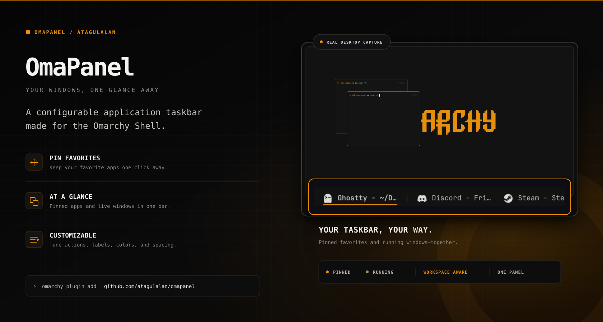

# OmaPanel

OmaPanel is a configurable application taskbar for the Omarchy Shell. It keeps
favorite applications pinned, adds live Hyprland windows, and provides
launch-or-focus behavior in a compact bar widget.



```text
[Zen] [Cursor] | [workspace 1 windows] | [workspace 5 windows]
     pinned                 running
```

The plugin uses the permanent namespaced ID `atagulalan.omapanel`.

## Highlights

- Pinned applications stay available even when they are closed.
- Multiple windows belonging to one pinned application appear as adjacent
  taskbar items instead of being collapsed into a single window.
- Left-click launches a closed application or focuses an existing window.
- Unpinned Hyprland windows appear automatically.
- Running windows can be grouped by workspace with separators between groups.
- Scrolling a multi-window pinned application cycles focus inside that
  application; scrolling a grouped running window cycles focus inside its
  workspace.
- Closed pinned applications can stay compact with icon-only mode.
- A dedicated Behavior tab maps left, right, middle, Ctrl+left, Shift+left,
  and Alt+left clicks to focus, launch, window, pin, menu, or settings actions.
- Normal, hover, and active states each have independent foreground,
  background, font-weight, and foreground-opacity controls.
- Application icon colors can be inverted without changing their transparency.
- Active-window indicators support `Underline`, `Top`, `Dot`, and `None`.
- Labels support `[APP_NAME]` and `[WINDOW_TITLE]` placeholders.
- Adaptive and fixed-width layouts include maximum width and ellipsis handling.
- The right-click menu provides:

  - all matching windows;
  - desktop-entry actions;
  - New Window;
  - pin and unpin;
  - Close Window and Close N Windows;
  - quick access to OmaPanel Settings.

- The built-in settings panel is split into General, Behavior, Layout, and
  Appearance tabs, saves changes immediately, and can restore manifest defaults.
- Colors, icons, typography, padding, spacing, rounding, filters, and separators are
  configurable.

## Requirements

- Omarchy with the Quattro shell
- Hyprland
- Quickshell and the Omarchy Shell QML modules
- `hyprctl` for focus and close actions

OmaPanel is a horizontal bar widget. It intentionally hides itself on vertical
bars.

## Installation

Install and enable OmaPanel from its public GitHub repository:

```bash
omarchy plugin add https://github.com/atagulalan/omapanel.git --enable
```

The manifest places the widget in the left section by default. Move it wherever
you prefer:

```bash
omarchy bar move atagulalan.omapanel --section center
```

If plugin discovery ever needs to be forced manually:

```bash
omarchy-shell shell rescanPlugins
```

## Updating and removing

```bash
omarchy plugin update atagulalan.omapanel --yes
omarchy plugin remove atagulalan.omapanel --yes
```

## Using OmaPanel

Left-click an item to launch or focus it. Right-click an item to open its
application menu.

Wheel down focuses the next window in the hovered group and wheel up focuses
the previous one, wrapping at either end. A pinned group contains all open
windows matching that pinned application. A running-window group contains the
visible windows from the same workspace when `groupRunningByWorkspace` is
enabled. Entering a group with no active member focuses the hovered chip first;
the next wheel step continues in the requested direction. A one-window group
keeps focus on its only window and consumes the gesture, while a closed pin
leaves it to the containing bar.

Use the gear button in the upper-right corner of that menu to open
**OmaPanel Settings**. Changes are written immediately to the
`atagulalan.omapanel` entry in:

```text
~/.config/omarchy/shell.json
```

The **Reset defaults** button restores values from `manifest.json`. It does
not edit the plugin files.

## Pinned applications

`pinnedApps` is stored as a JSON-encoded string because it is a single shell
setting. Each application supports:

```json
{
  "label": "Zen",
  "match": "^zen$",
  "launch": "omarchy-launch-browser",
  "icon": "zen-browser",
  "desktopId": "zen"
}
```

| Field | Purpose |
|---|---|
| `label` | Name displayed in the bar |
| `match` | Case-insensitive regular expression matched against Hyprland class, initial class, and Wayland app ID |
| `launch` | Command used when no matching window exists |
| `icon` | Freedesktop icon name, file URL, or absolute path |
| `desktopId` | Desktop entry used for New Window and application actions |

Pinned applications are best managed from the right-click **Pin to Taskbar**
and **Unpin from Taskbar** actions.

## Label templates

`labelFormat` supports two placeholders:

- `[APP_NAME]`: the resolved desktop-entry or window-class name;
- `[WINDOW_TITLE]`: the current Quickshell or Hyprland IPC window title.

Example:

```text
[APP_NAME] - [WINDOW_TITLE] -> Ghostty - ~/Projects/omapanel
```

## Configuration

The complete settings reference, value ranges, color behavior, and
`pinnedApps` format are documented in
[`docs/SETTINGS.md`](docs/SETTINGS.md).

A complete shell entry is available in
[`examples/shell-entry.json`](examples/shell-entry.json).

## Development

OmaPanel follows the Omarchy plugin manifest contract. Work in a user-owned
plugin directory and never edit the packaged shell under
`/usr/share/omarchy/`.

Validate the repository before publishing:

```bash
/usr/lib/qt6/bin/qsb --qt6 --qsbversion 64 -O \
  -o shaders/invert.frag.qsb shaders/invert.frag
jq empty manifest.json examples/shell-entry.json
qmlformat -n BarWidget.qml >/dev/null
qmlformat -n TaskbarSettings.qml >/dev/null
omarchy plugin validate .
```

The shell reloads plugin files automatically. For a clean-start test:

```bash
omarchy restart shell
omarchy-shell shell ping
```

Implementation details are available in
[`docs/IMPLEMENTATION.md`](docs/IMPLEMENTATION.md).

## Security

Omarchy plugins run unsandboxed with the current user's permissions. Review the
source and every configured launch command before installation. OmaPanel does
not require elevated privileges.

## License

[MIT](LICENSE)
